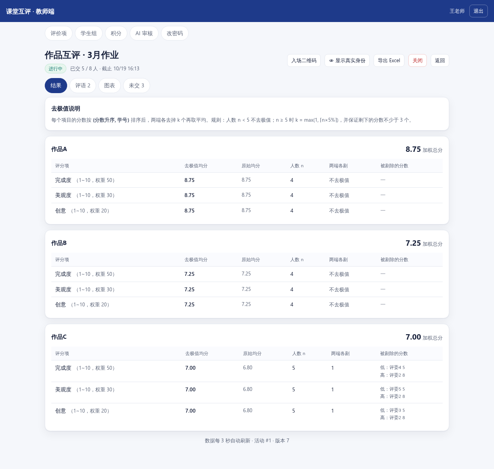
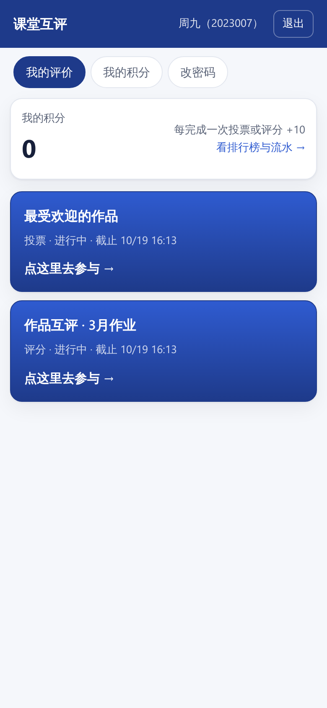
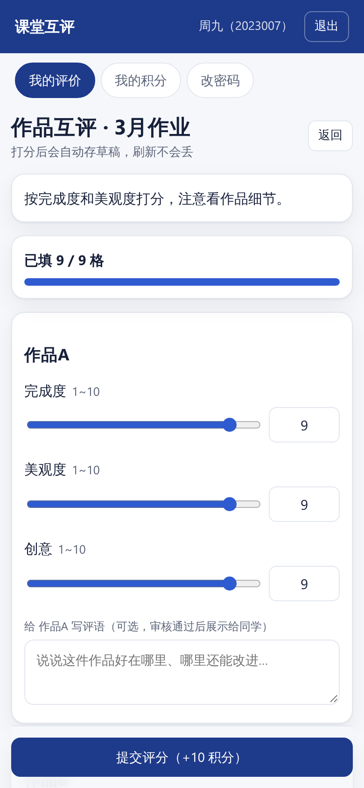

# 课堂互评 / 投票评分系统

> 把讲评课从「老师一个人点评」变成「全班一起评」。
> 学生扫码给同学的作品打分、写评语；老师把结果投在大屏上，分数分布和评语墙当场就出来。
> **单机 Docker，50 人规模，中文界面，装在自己电脑或 NAS 上。**

[](#快速开始)
[](#技术栈)
[](#license)

---

## 为什么做这个

讲评课常见的场面：老师在台上讲，学生在下面听。作品只有老师看过，意见也只有老师说得出来——学生既没仔细看过同学的作业，也没机会说点什么。

想让学生互评，以前得靠纸质表格或者群里接龙：匿名保不住、统计麻烦、意见散了收不回来、当堂出不了结果。最后往往还是变回老师一个人讲。

这个系统想做的是**让评价真的发生在全班之间**：

- **学生当堂看同学的作品**（只显示「作品A / 编号03」，不看名字），打分 + 写评语
- **老师投大屏看实时结果**：谁的分高、大家怎么评的、评语热词是什么
- **好的评语被全班看到**，而不是只记在老师本子上
- **匿名降低「怕得罪人」的心理负担**，学生更敢说真实想法；老师点「小眼睛」仍能看真名
- **打分必须打满**，逼着学生把每一项都看过再给分，而不是随手点个 8 分

顺带省下来的：去极值、加权、谁没交、导出 Excel，都是自动的——但这只是副产品，不是重点。

没有云服务、没有账号体系，局域网内、断网也能跑（AI 评语审核是可选功能）。

---

## 跟学习通的「生生互评」比

学习通（超星泛雅）的作业里也有生生互评：老师在作业设置里勾选，能设打分指标、互评时间、互评份数和是否匿名，学生互相打分后系统自动取平均分（[超星作业设置操作流程](https://jwc.suibe.edu.cn/_upload/article/files/bb/2f/5df7d5814789b1213d4bef7e4ea7/59a35047-1a98-4ad2-88c9-4d8178f18107.pdf)）。

这套机制本身没毛病。我不用它，是因为**它首先是一个作业系统，互评是作业里的一个附属选项**：

- 要先建课、学生加入课程，再发一次作业，学生才在「作业」里看到「待批阅」的入口
- 学生互相打分 → 系统取平均，**没有去极值**
- 互评结束就结束了：学生看不到彼此怎么评的，课堂上也没有过程可看
- 结果是后台数据，想当堂投给学生看要另外折腾

这个系统是照着「**一节课**」做的，不是照着「一个学期」做的：

| | 学习通 · 生生互评 | 这个系统 |
|---|---|---|
| 前提 | 建课 + 学生入课 + 发作业 | 建学生组，粘贴「学号,姓名」批量导入 |
| 学生入口 | 作业 → 待批阅 | **扫码直接进**，首页就是「未参与 / 已参与」 |
| 评分算法 | 相互打分**取平均** | **去极值**平均，剔除哪一条分数写在表里，可追溯 |
| 匿名 | 一个开关 | 身份照常记录但接口不下发；老师「小眼睛」另走鉴权接口 |
| 评语 | 老师批阅 | AI 审核 → 上墙 → 同学发表情互动 |
| 课堂现场 | 后台看结果 | **投屏实时**：票数条、均分、雷达图、评语墙、热词、未交名单 |
| 互动反馈 | 提交即结束 | 十种表情、积分、🚨 五人折叠 |

**学习通更强的地方也得说**：学生本来就有账号和 App、跟成绩册打通、有通知提醒、多门课统一管、不用自己部署。
如果你的需求是「一个学期的一门课，作业互评算平时分」，学习通够用。

如果你想要的是「**这节课上，全班一起看看同学的作品、说说好在哪**」——那它太重了，而且学生之间其实是隔开的。

---

## 一节课怎么用

1. **课前 30 秒**：建学生组，粘贴「学号,姓名」导入（初始密码就是学号）；发起一次评分，勾选参与的学生，定好评分项。
2. **上课时**：老师点「入场二维码」投到大屏，学生扫码 → 学号登录 → 自己的作品列表。
3. **学生端**：看到的是「作品A / 作品B / 作品C」，不知道是谁的。逐个打分（滑块+数字），打满才能提交，可以给每个作品写一条评语。
4. **讲评时**：老师切到结果页投屏——各作品均分、被剔除的极值、柱状图雷达图、评语墙、谁还没交，边讲边刷新。
5. **课后**：学生也能看到结果和评语墙，给同学写的评语点表情；老师一键导出 Excel。

整个过程学生不需要装 App、不需要注册、不需要加入课程——扫个码就进来了。

---

## 截图

| 教师端 · 去极值明细 | 教师端 · 图表 |
|---|---|
|  |  |

| 学生端 · 活动列表 | 学生端 · 打分（手机） |
|---|---|
|  |  |

更多截图在 [`docs/screenshots/`](docs/screenshots/)。

---

## 功能

**教师端**
- 学生组管理，粘贴或 CSV 批量导入（学号+姓名），初始密码=学号，首次登录强制改密
- 发起**投票**（≤10 选项、单选/多选、定时关闭、可选配图）
- 发起**评分**（≤20 个评分项、自定义分值区间与权重、指定被评对象、上传作品图/视频）
- **评分项可存成模板**：下次一键套用；也会自动记住上一次用的评分项，不用每次重敲
- **被评对象可按学生组批量添加**：选组 → 一键把整组学生加成「作品A/作品B/…」，关联学生下拉也按组分类
- 实时结果：去极值均分、原始均分、有效人数、被剔除的分数、柱状图、雷达图
- 评语墙：AI 审核 → 待审队列 → 放行/驳回；热词云
- 小眼睛：一键看真实身份（走独立鉴权接口，默认不下发）
- 积分：手动加减分（可以扣成负数）、排行榜
- 导出 Excel（6 个 Sheet，含原始分与极值标注）
- 文件夹归档、入场二维码

**学生端**
- 扫码 → 学号登录 → 改密码
- 深蓝卡=还没参与，浅蓝卡=已参与
- 打分（滑块+数字，自动存草稿）、写评语、发表情
- 匿名看结果、看评语墙、看积分与班级排行榜

**管理端**
- 开通/禁用教师账号
- 全局 AI 审核兜底配置（服务商下拉 + 测试连接）

---

## 快速开始

```bash
git clone https://github.com/bmbingmao/classroom-peer-review.git
cd classroom-peer-review/app
cp .env.example .env      # 改 ADMIN_PASSWORD
docker compose up -d --build
```

浏览器打开 `http://<本机局域网IP>:3000`，用 `.env` 里的 `admin` 账号登录（首次登录强制改密）。

**学生入场**：老师发起活动后点「入场二维码」，投屏让学生扫。

### ⚠️ 三个必看的坑

1. **`COOKIE_SECURE` 必须是 `false`**（局域网是 HTTP）。设成 true 会表现为"登录后跳回登录页"。
2. **数据卷别挂到 SMB/NFS 共享目录**。SQLite 的 WAL 在网络文件系统上会直接打不开库。用命名卷或 NAS 本地盘。
3. **`ADMIN_PASSWORD` 只在首次启动生效**（库里还没有 admin 时）。

### Docker Hub 拉不动？

国内网络经常拉不到基础镜像，配镜像源：

```bash
sudo tee /etc/docker/daemon.json >/dev/null <<'EOF'
{ "registry-mirrors": ["https://docker.m.daocloud.io", "https://docker.1ms.run", "https://dockerproxy.net"] }
EOF
sudo systemctl restart docker
```

---

## 部署到 NAS（飞牛 / 群晖 / 1Panel）

见 [`docs/部署-飞牛NAS.md`](docs/部署-飞牛NAS.md)，含：
- 在开发机上打包镜像 → scp 到 NAS 导入（**NAS 完全不用连 Docker Hub**）
- 端口冲突、数据卷、备份、升级、常见故障

---

## 技术栈与设计取舍

| 层 | 选型 | 为什么 |
|---|---|---|
| 运行时 | Node ≥ 22.6 | **原生跑 TypeScript**（类型剥离），服务端零编译步骤 |
| 数据库 | `node:sqlite`（内置） | 免原生模块编译 —— NAS 上装 better-sqlite3 要编译链，这是最大的部署坑 |
| 后端 | Express 4 + WAL + `busy_timeout` | 50 人并发读写不互相阻塞 |
| 前端 | React 18 + Vite | 单页，hash 路由，无额外路由库 |
| 图表 | 手写 SVG | 只需柱状图+雷达图，ECharts 要多 1MB |
| Excel | exceljs | `xlsx`(SheetJS) 的 npm 版停在 0.18.5，有已知 CVE |
| 密码 | bcryptjs | 纯 JS，免编译 |
| AI 审核 | OpenAI 兼容接口 + 异步队列 | 提交立即返回，8 秒超时，失败一律进待审，不阻塞学生 |

**几个刻意的设计**

- **打满才能提交**：服务端二次校验，缺一格返回 400 并给出缺口列表。
- **草稿与正式分分离**：草稿存 `score_drafts`，正式分只在提交时原子写入，避免半截数据污染统计。
- **去极值排序键 `(分数, 学号)`**：保证同分时剔除对象稳定，重算结果可复现。
- **匿名是"不记录"的反面**：身份照常记录（发积分、小眼睛要用），但**接口不下发**，学生抓包也看不到。
- **AI 审核异步化**：同步调模型会让提交卡 5~10 秒；现在是提交即返回、后台判。

---

## 测试

```bash
cd app
./scripts/verify.sh   # 一条命令跑完接口+界面+并发三套
```

| 套件 | 数量 | 覆盖 |
|---|---|---|
| 接口冒烟 | 136 项 | 去极值算法（n=1..100 的 k 值、并列、权重全 0）、强制改密、批量导入、打满校验、草稿、匿名脱敏、自评排除、权限隔离、到期自动关闭、积分只发一次、改投不重复加分、二维码、媒体上传鉴权、防目录遍历 |
| P1 接口 | 80 项 | 评语状态机、小眼睛、表情扣分/加分/防刷/🚨折叠、负分、排行榜、Excel 六 Sheet、AI 放行/驳回/超时/未配置 |
| 界面冒烟 | 39 项 | jsdom 渲染生产包：登录 → 结果页 → 二维码 → 强制改密 → 深蓝卡 → 滑块 → 提交 → 投票 |
| 并发 | 50 人 | 同时提交 39ms 全过，不丢分 |

真浏览器验证（Playwright，需自装）另有 27 + 23 项。

---

## 适用范围与免责

- 定位是**个人/科组自用的教学工具**，不是产品级 SaaS。
- 面向**局域网**（教室、机房）。**未做公网加固**——要放公网请自己加 HTTPS、反向代理和限流。
- 多教师数据隔离做了（每条 SQL 带 `teacher_id`），但没有审计日志、没有备份策略（给了备份命令）。
- 不承诺响应 issue，但欢迎提。

---

## License

[MIT](LICENSE)
